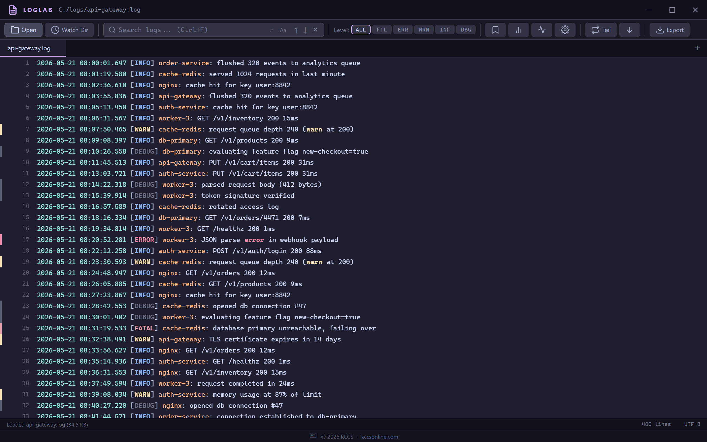
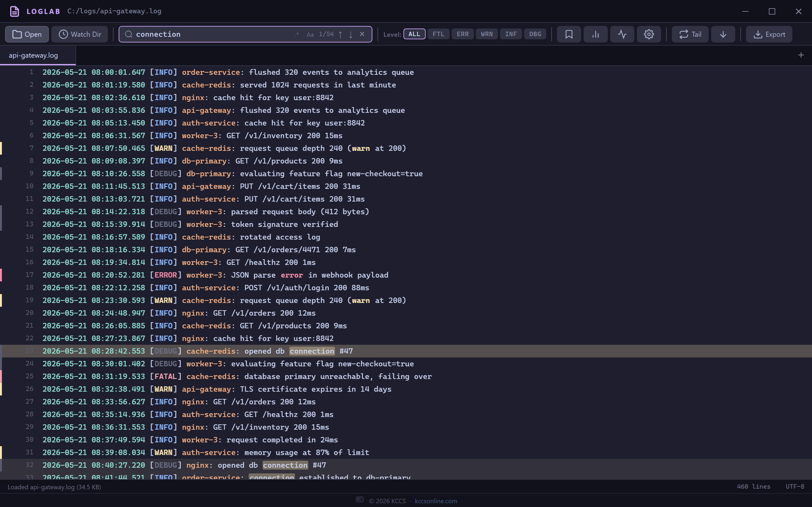
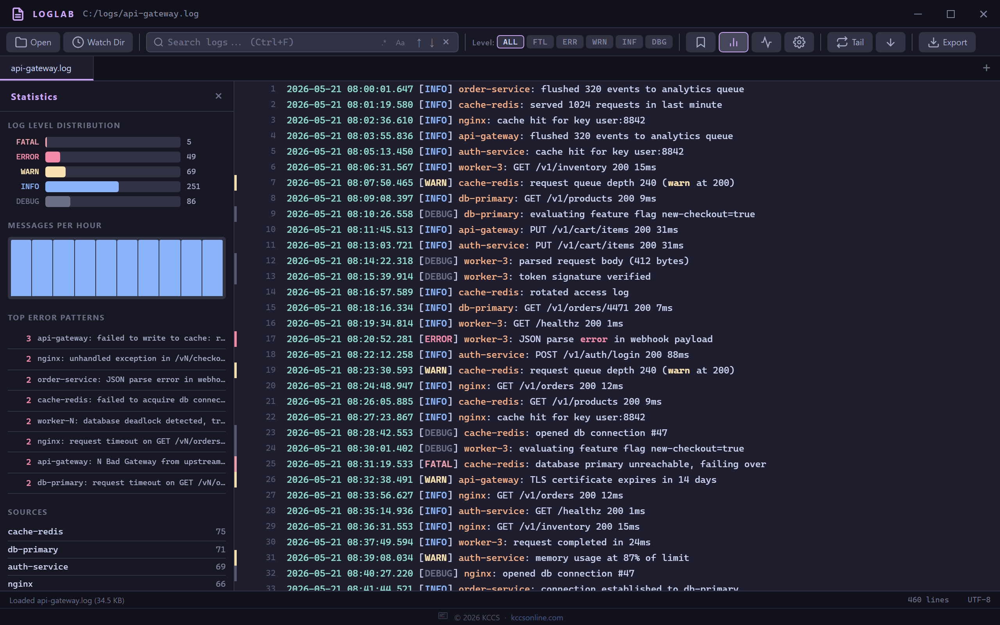

```
██╗      ██████╗  ██████╗ ██╗      █████╗ ██████╗
██║     ██╔═══██╗██╔════╝ ██║     ██╔══██╗██╔══██╗
██║     ██║   ██║██║  ███╗██║     ███████║██████╔╝
██║     ██║   ██║██║   ██║██║     ██╔══██║██╔══██╗
███████╗╚██████╔╝╚██████╔╝███████╗██║  ██║██████╔╝
╚══════╝ ╚═════╝  ╚═════╝ ╚══════╝╚═╝  ╚═╝╚═════╝
   a fast desktop log analyzer that eats millions of lines for breakfast
```

<p align="center">
  
  
  
  
</p>

LogLab handles millions of log lines without breaking a sweat. Virtual scrolling keeps the UI smooth no matter how large the file. Built for developers and sysadmins who live in logs.

---

## Screenshots

| Log Viewer |
|:----------:|
|  |

| Search & Filter | Statistics |
|-----------------|------------|
|  |  |

---

## Features

### Viewing
- **Virtual scrolling** — renders only visible lines, handles files with millions of entries
- **Multi-tab** — open multiple log files simultaneously, switch instantly
- **Line wrap toggle** — switch between truncated and wrapped display on the fly
- **Font size control** — 10–18px, saved to preferences
- **Syntax highlighting** — timestamps, log levels, source names colored automatically
- **Gzip support** — open `.gz` compressed log files directly, no manual decompression
- **UTF-8 and UTF-16LE** — UTF-16 logs (e.g. PowerShell `>` redirects) are detected by their byte-order mark
- **Open with / double-click** — `.log` and `.txt` files opened from Explorer load straight into a tab
- **Drag & drop** — drop files directly onto the window to open them
- **Recent files** — quick-access list of the last 20 opened files

### Search
- **Quick search bar** (Ctrl+F) — real-time highlighting as you type
- **Regex search** — full regex support with case sensitivity toggle. Patterns with nested quantifiers like `(a+)+`, which can hang the app, are rejected, and a search that runs more than a few seconds stops and says its results are partial
- **Match navigation** — F3 / Shift+F3, or arrow buttons to jump between matches
- **Advanced search** (Ctrl+Shift+F) — multi-criteria filter with:
  - Text pattern (regex or literal)
  - Date range filtering (from / to timestamps)
  - Level filter
  - Source name filter
  - Live preview of matching line count before applying
- **Clear filter** — Ctrl+L clears the active search/filter instantly

### Analysis
- **Statistics panel** — level distribution bar chart, messages-per-hour histogram, top error patterns, source breakdown
- **Timeline view** — horizontal density chart showing log activity over time
- **Error pattern clustering** — normalizes numbers to group repeated error messages
- **Bookmarks** — mark important lines, navigate between them from the bookmarks panel, persisted per file

### Tail Mode
- **Live file tailing** — watches the file for new content as it's written
- **Auto-scroll** — keeps the view pinned to the bottom as new lines arrive
- **Real-time stats** — hourly chart, error patterns, and level counts update as new lines come in
- **Rotation handling** — detects truncation (copytruncate) and rename-style rotation and continues from the start of the new file
- Only complete lines are shown; a line still being written appears once its newline arrives
- Not available for `.gz` files

### Other
- **Export** — save filtered results as CSV or JSON
- **Directory watch** — watch a folder (2 levels deep) and auto-open log files as they appear (up to 5 open tabs)
- **System tray** — minimize to tray, Ctrl+Shift+L to show/hide
- **Persistent window state** — position and size remembered between sessions
- **Settings panel** — font size, line wrap, max lines limit, auto-tail on open

---

## Keyboard Shortcuts

| Shortcut | Action |
|---|---|
| `Ctrl+O` | Open file(s) |
| `Ctrl+F` | Focus quick search |
| `Ctrl+L` | Clear current filter |
| `Ctrl+G` | Go to line number |
| `Ctrl+Shift+F` | Open advanced search |
| `Ctrl+B` | Toggle bookmarks panel |
| `Ctrl+W` | Close current tab |
| `F3` | Next search match |
| `Shift+F3` | Previous search match |
| `Ctrl+Shift+L` | Show / hide window (global) |
| `Escape` | Close modals / blur search |

---

## Supported File Formats

| Extension | Description |
|---|---|
| `.log` | Generic log files |
| `.txt` | Plain text |
| `.syslog` | Syslog format |
| `.err` | Error logs |
| `.out` | Stdout captures |
| `.csv` | Comma-separated values |
| `.gz` | Gzip-compressed versions of any of the above |

**Auto-detected log formats:**
- ISO 8601 timestamps (`2024-01-15T10:30:00Z`)
- Standard log timestamps (`2024-01-15 10:30:00`)
- Syslog format (`Jan 15 10:30:00 hostname process[pid]:`). Syslog has no year, so the current year is assumed, or last year if that would put the line in the future
- Apache/Nginx access logs (`[15/Jan/2024:10:30:00 +0000]`)
- Epoch timestamps (10-digit seconds at the start of the line)

Timestamps without a time zone are treated as local time. Messages-per-hour buckets are in local time.

---

## Installation

### Run from source

```bash
git clone https://github.com/pueblokc/loglab.git
cd loglab
npm install
npm start
```

### Build installer

```bash
npm install
npm run build
```

Produces a Windows NSIS installer and a portable `.exe` in `dist/`.

### Build directory (no installer, faster)

```bash
npm run build:dir
```

---

## Build Requirements

- Node.js 20+
- npm 9+
- Windows (builds Windows targets only)

`electron-builder` handles packaging. No additional tools needed.

---

## Development

```bash
npm test       # node:test unit tests (no Electron needed)
npm run lint   # ESLint
```

CI (`.github/workflows/ci.yml`) runs both on Ubuntu and Windows. See [ARCHITECTURE.md](ARCHITECTURE.md) for how the app is put together.

---

## Tech Stack

| Component | Technology |
|---|---|
| Framework | Electron 44 |
| Renderer | Vanilla JS (no framework) |
| Styling | CSS custom properties, Catppuccin Mocha palette |
| File watching | chokidar 4 |
| Gzip decompression | Node.js `zlib` (built-in) |
| Packaging | electron-builder |
| IPC | Electron contextBridge (context isolation + sandbox, strict CSP) |

---

## Configuration

Settings are stored in `loglab-prefs.json` in the per-user app data folder (`%APPDATA%\LogLab` on Windows; `~/.config/loglab` when run from source on Linux). Bookmarks and recent files are kept in the same file. You can edit it directly or use the Settings panel (gear icon in toolbar). A `loglab-prefs.json` left next to the app by v1.0.0 is copied over automatically on first run.

Available settings:

| Key | Default | Description |
|---|---|---|
| `fontSize` | `12` | Log viewer font size in px (10–18) |
| `lineWrap` | `false` | Word-wrap long lines (experimental: with very long lines the virtual scroller can overlap rows) |
| `theme` | `catppuccin-mocha` | UI theme |
| `maxLines` | `500000` | Max lines loaded per file |
| `autoTailOnOpen` | `false` | Start tailing immediately when a file opens |

---

## License

MIT — see `LICENSE` file.

---

*Built by [KCCS](https://kccsonline.com)*
